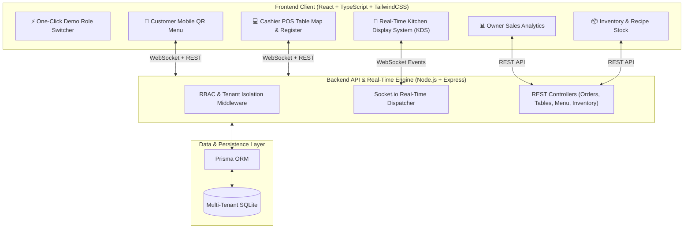
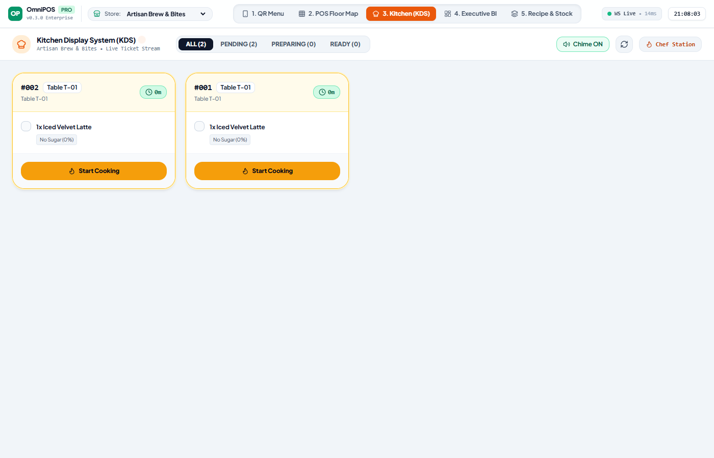

# 🍽️ OmniPOS: Multi-Tenant Restaurant POS & Real-Time Kitchen Display System

[](https://www.typescriptlang.org/)
[](https://react.dev/)
[](https://nodejs.org/)
[](https://www.prisma.io/)
[](https://socket.io/)
[](https://tailwindcss.com/)
[](https://opensource.org/licenses/MIT)

> **OmniPOS** is an enterprise-grade, multi-tenant Restaurant & Cafe Management SaaS platform engineered with full-stack best practices. It features seamless QR mobile self-ordering, interactive cashier POS table floor maps, real-time Kitchen Display Systems (KDS) with WebSockets, automated raw recipe inventory deduction, and executive analytics.

---

## 🌟 Key Features & Views

| View | Target User | Description |
| :--- | :--- | :--- |
| 📱 **Customer QR Menu** | Diners / Guests | Mobile-first self-ordering, customized modifiers (sweetness, oat milk), live order tracking & status updates |
| 💻 **Cashier POS Register** | Staff / Cashiers | Interactive table floor map (Occupied/Open), bill creation, dynamic discounts, and instant payment settlement |
| 🍳 **Kitchen Display (KDS)** | Chefs / Kitchen | Real-time Kanban ticket board with live audio alerts, cooking timers, and dish-by-dish checklist bumping |
| 📊 **Owner Analytics** | Restaurant Owners | Executive BI dashboard with hourly sales velocity, top 5 dishes, and tender breakdown (PromptPay / Cash / Card) |
| 📦 **Inventory & Recipes** | Kitchen Managers | Automated recipe ingredient deduction (e.g. 1 Latte deducts 18g beans & 150ml milk), low-stock warnings, and 1-click restock |

---

## 🏗️ System Architecture



---

## 🚀 Quick Start Guide

### Prerequisites
- **Node.js**: v24
- **npm**: v9.0.0 or higher
- **Windows**: clone into an ASCII-only path such as `C:/projects` so Prisma can create the SQLite file.

### Installation & Setup

```bash
# 1. Clone the repository
git clone https://github.com/Jakkapon-Dev/Multi-Tenant-POS-Queue-Management.git
cd Multi-Tenant-POS-Queue-Management

# 2. Install dependencies
npm ci --prefix server
npm ci --prefix client

# 3. Copy the sample settings (PowerShell users: Copy-Item server/.env.example server/.env)
cp server/.env.example server/.env

# 4. Create and seed the local SQLite database
npm run prisma:push --prefix server
npm run seed --prefix server
```

Seeding clears the configured database before loading sample data. Use the SQLite database from the sample settings.

Start the API and app in separate terminals from the repo root.

```bash
# Terminal 1
npm run dev --prefix server

# Terminal 2
npm run dev --prefix client
```

### Demo: Send an order to the kitchen



1. Open [OmniPOS](http://localhost:5173) in two tabs and select **Artisan Brew & Bites** in both.
2. In the first tab, open **3. Kitchen (KDS)**. Keep that tab open.
3. In the second tab, open **1. QR Menu** to simulate a scan at the sample table. Select **Iced Velvet Latte**, choose **Add to Order**, then open **Review Cart** and click **Send Order to Kitchen**.
4. The kitchen tab receives the ticket without a refresh. Compare the order number on the ticket with the one in the customer tab.

The sample settings enable the role switcher for a local demo with sample data. The order list and KDS API require a staff token scoped to the requested store outside local demo mode.

---

## 📦 Version Progression & Roadmap

### 🟢 Version 1.0 (v0.1.0) — Core Engine & Ordering Flow
- Monorepo structure with strict `.gitignore` and security configuration.
- Prisma multi-tenant data schema (Tenant, User, Category, MenuItem, Modifiers, Tables, Orders).
- REST APIs for authentication, menu CRUD, and table floor map lookups.
- Customer mobile QR menu and Cashier POS table interface.

### 🟡 Version 2.0 (v0.2.0) — Real-Time KDS & Multi-Tenancy
- Socket.io integration for instant order synchronization across kitchen and tables.
- Real-time Kitchen Display System (KDS) with audio chimes and elapsed timers.
- RBAC and Tenant Data Isolation middleware.
- Automated unit test suite with 13/13 passing assertions.

### 🔵 Version 3.0 (v0.3.0) — Analytics, Inventory & Demo Polish
- Raw ingredient inventory tracking with automated recipe deduction on order completion.
- Owner analytics dashboard with peak-hour sales velocity and top dish rankings.
- PromptPay QR, Cash change calculator, and thermal receipt printing simulation.
- One-click recruiter demo mode toolbar.

---

## 🧪 Automated Testing

Run the unit tests and the order-list integration test. The integration test creates and removes its own SQLite database.
```bash
npm run test --prefix server
```

---

## 🛡️ Security & GitHub Safety Guidelines

For complete guidelines on keeping GitHub repositories secure from accidental secret leaks and account flags, review [GITHUB_SAFETY_GUIDE.md](./GITHUB_SAFETY_GUIDE.md).

---

## 📄 License
This project is open-source under the [MIT License](LICENSE).
